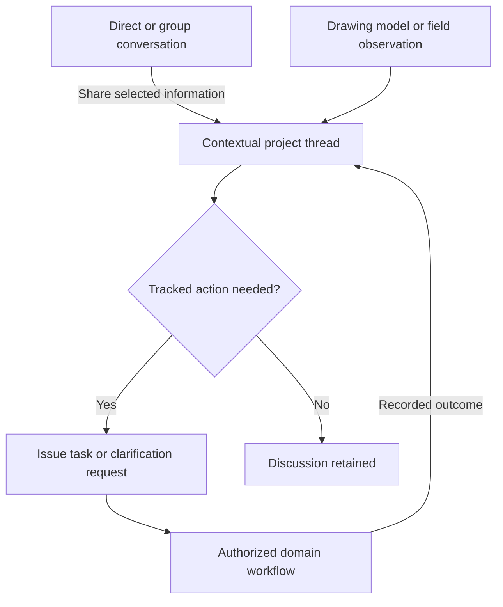

# Fadi Communication Concept

**Conversations Context Responsibilities and Recorded Outcomes**

Version 1.0 | 21 October 2026 | Product concept for validation

Fadi COM connects the people involved in a project to the information, conversations and responses needed to move the work forward. It supports internal team communication, collaboration between organizations, field-to-office exchanges and external review while preserving the context, audience, responsibilities and history of each exchange.

The proposed capability combines two communication modes: conversations about identified project work, and direct or group conversations between people. Both use the same identities, access rules and history, with an explicit path from discussion to an assigned action or formal request.

COM belongs within Collaboration, with contextual access from Studio, Parcours, Documents and the project workspace. The concept builds on the Studio reference and Users Management Concept v2. Studio already distinguishes annotations, observations, tasks and decisions and requires each to retain its exact context. Its responsibility remains design: field information can become a design input while the originating construction activity retains its own management responsibility. [1][2]

This document defines the proposed product behavior, interface placement, delivery sequence and acceptance scenarios. Implementation readiness depends on validating the shared identity, access, revision and workflow capabilities on which COM relies.

| Part | Expected outcome |
| --- | --- |
| 1 Consolidated concept | Two communication modes connected to shared project work and explicit audiences. |
| 2 Define access and ownership | Clear authorship, stewardship, response accountability, authority and history rules. |
| 3 Design the journeys | Complete office and field journeys, including offline capture and recovery. |
| 4 Deliver external review | Focused review of identified packages by named external participants. |
| 5 Extend organization management | Internal communication, enterprise mapping and continuity across team changes. |
| 6 Extend collaboration where needed | Selected BIM, CAD, email, meeting and AI capabilities that preserve source authority. |

## Design assessment

The foundation is the distinction between contextual exchanges and ordinary conversations, supported by a complete field-to-office response journey. The following refinements make the initial proposal consistent with Fadi's existing concepts.

| Initial proposal | Refinement adopted in this concept |
| --- | --- |
| A standard chat message belongs to a person. | A message has an author and belongs to a conversation with an identified audience. |
| Combine all channels into one project timeline. | Provide project activity filtered by each participant's permissions; private conversations retain their own audience. |
| Define access by Owner, GC, Subcontractor and Architect. | Use business-role templates, then assign actions, resources, scope and duration to actual participants. |
| Make all sent communication immutable. | Preserve formal issued records through traceable corrections, supersession and withdrawal, with a separate policy for ordinary conversations. |
| Deliver a two-click field journey. | Provide fast capture with inherited context and validate completion steps and time with representative users. |
| Give guests view-only or comment-only access. | Assign the external participant's actual responsibility, which may include formal approval. |
| Add deep integrations and AI. | Introduce selected integrations after the core communication, access and history rules work reliably. |

The Autodesk construction-app reference supports the field-to-office use case through examples connecting photos, files, requests for information and responsibilities, including offline access to drawings and models. These examples inform the direction; Fadi defines its own audience, authority and ownership rules below. [3]

## 1 Consolidated concept

### Three human contexts

COM supports the three contexts established by Users Management. [2]

| Context | Communication supported | Boundary |
| --- | --- | --- |
| Fadi internal platform team | Product discussions, development coordination, operations and support cases. | Customer communications require explicitly authorized support access. |
| Organization internal team | Internal design discussions, discipline coordination, preparation of responses, resource discussions and exchanges across authorized projects. | Internal exchanges stay within the organization or selected group until information is deliberately shared. |
| Project Team and Participants | Exchanges between clients, project leads, architects, engineers, consultants, contractors, suppliers and other participants. | Visibility follows project responsibilities and assigned access. |

These contexts overlap through the same people and participation records. An architect can discuss a design internally with their practice, coordinate with an external engineer in a project thread and send a selected response to the client. The exchanges have different audiences even when they concern the same drawing.

The project team is the operational connection between the participating organizations and the work. Organizations can be addressed or represented, while individual people perform attributed actions. A contact without an account can appear in the directory; it must not appear to have authenticated, read or approved material inside Fadi.

### Contextual conversations

A contextual conversation concerns an identified piece of project work. Its primary context can be a project, Parcours step, study, variant, drawing revision, model element, saved viewpoint, document, dossier, review package, location, field observation, issue, task or clarification request.

For example: "The opening shown on drawing A-204, revision R03, conflicts with the structural beam at Level 2."

Fadi retains the drawing identity, revision, location or object reference, supporting photo, author, audience and requested response. If R04 is later issued, the original observation remains attached to R03. A subsequent response can reference R04 as the proposed correction.

Locations distinguish a drawing pin, a model coordinate and a geographic position. Each location identifies its reference system and source. It must not move silently when a drawing or model changes. An ambiguous or broken association is visible and requires resolution.

### Direct and group conversations

Direct and group conversations support everyday exchanges without requiring an artifact at the outset. For example: "Can we review the entrance options tomorrow?"

Each conversation has named participants and a declared context, such as an internal organization group, a project group or a direct exchange between authorized participants. A message can mention a person, project, drawing or task. Mentioning a project does not publish the conversation into that project's shared history.

**A message is authored by a person, belongs to a conversation and may reference project work.**

Both communication modes share consistent behavior for attachments, replies, corrections, audience visibility and delivery status. General chat is an explicit extension proposed here; Users Management v2 did not make it a prerequisite of its initial scope. [2]

### From conversation to action

The Create linked action capability lets an authorized participant use a message or selected exchange to create an issue, assign a task, prepare a clarification request, submit material for review or propose a decision to the appropriate authority.

Before confirmation, Fadi shows the information to be shared, its destination and its audience. The original conversation retains its audience. A wider project audience receives only the information explicitly selected for sharing.

An architect can publish the agreed technical answer from an internal discussion without exposing internal commercial comments or unfinished alternatives. The shared contribution preserves suitable provenance without revealing restricted source content or metadata.

### Project activity and personal inbox

Project activity shows authorized events within one project: shared messages, observations, assignments, review responses, recorded decisions and issued information.

My inbox shows what requires the individual's attention across authorized contexts: direct messages, mentions, assigned questions, reviews, overdue responses and publication notices.

Project filters include needs my response, unresolved questions, discipline or work package, study, location, document, reviews and decisions, issued information, date and author. Each entry identifies its source and current meaning. Comments, task completions and approvals have distinguishable labels.

The feed provides navigation into records. The underlying message, issue or decision remains the reference. Offline and imported events distinguish capture time from server receipt time; a late upload must not silently rewrite the apparent sequence of earlier decisions.

### Responsibility for shared records

| Capability | Proposed responsibility |
| --- | --- |
| Users Management | Identity, organization membership, project participation, invitations and access assignments. |
| COM | Conversations, messages, audiences, communication routing, delivery status, acknowledgments and attention views. |
| Shared Collaboration records | Issues, tasks, coordination actions and structured clarification requests. |
| Studio | Design content, revisions, design checks and the applicable design approval workflow. |
| Documents | Document versions, shared packages and release functions within its defined scope. |
| Parcours | Project steps and their associated work context. |

COM can present an approval action, but the action invokes the authoritative workflow and displays its recorded result. Studio requires approval to concern an identified revision or dossier and handles publication separately. [1]

The first scope includes a structured Clarification Request with a question, references, requester, accountable responder, due date, response and closure history. Formal RFI procedures, daily logs and commercial change orders require additional lifecycle definitions. Communication about a change order references its authoritative record rather than creating a second commercial approval inside chat.

## 2 Define access and ownership

### Participants actions and scope

Owner, general contractor, architect and subcontractor are business descriptions that can inform templates. Actual access depends on the participant's assignments. A contractor may coordinate several packages; an architect may act only as a specialist; a client representative may approve one dossier while having no access to internal design discussions.

Every permission identifies which participant may perform which action, on which conversation or resource, during which period and under whose authority. Actions include viewing, posting, attaching files, inviting participants, sharing extracts, managing conversations, exporting, acknowledging, assigning and performing formal workflow actions.

Portfolio visibility is explicitly granted. A GC or management role does not automatically reveal every project. Active identity, participation, grants, restrictions, dates and workflow conditions follow the effective-access rules defined by Users Management. [2]

OWASP recommends denying access by default and validating permissions on every request. Fadi applies these principles when opening a linked file, viewing a preview, performing an action or exporting a conversation. [4]

### Visible audiences

The composer displays a plain-language audience before sending or sharing. Examples are "Visible to: Internal architecture team" and "Visible to: Project A - client representative, architect and structural engineer."

Changing an audience is a distinct action. Adding a person to a group explains what history they will receive. The proposed defaults are:

- Internal organization discussions remain internal.
- Contextual project threads use an explicitly selected project audience.
- External review discussions inherit the review package's audience.
- Direct conversations remain limited to their participants.
- A mention or assignment never grants access to restricted material.

A restricted drawing's title, thumbnail or attachment must not leak through a link posted to a wider conversation. Search, notification previews, exports and AI summaries follow the same visibility boundaries.

### Authorship accountability and authority

| Responsibility | Meaning |
| --- | --- |
| Author | The person who created the message or recorded the action. |
| Conversation steward | The participant authorized to organize membership and conversation settings. |
| Accountable responder | The person responsible for answering the request or completing an action. |
| Decision authority | The person authorized to make the relevant business decision for the specified scope. |

The organization represented at the time is recorded separately. Earlier messages and decisions retain their original attribution when a person leaves an employer. Replacements receive responsibilities through reassignment or delegation.

Platform administrators receive attributable, limited support access when authorized. Technical administration does not confer professional approval powers.

### History corrections and retention

Drafts can be edited or discarded by their authors before submission. Ordinary conversations follow a defined editing and withdrawal policy, with visible indications and appropriate history.

Formal issued records retain their original recorded state. Submitted requests, official responses, decisions, approvals and releases are corrected, superseded or withdrawn through new attributed events.

Retention and exceptional redaction are defined by record category and project policy. The concept does not prescribe indefinite retention of every message or every copy. Redaction or disposal records the authorized action and preserves the evidence required by the applicable policy.

Protecting history requires controls in the underlying record system, beyond disabling an Edit button. OWASP's logging guidance addresses detecting modification or deletion, restricting access to logs and defining retention periods. [5]

Fadi makes precise claims about recorded identity, timing, content and workflow authority. Contractual use of those records is defined through the project's agreed procedures.

## 3 Design the journeys

### Field observation to office response

The first complete operational scenario connects a field observation to an accountable office response and returns the outcome to the appropriate field participants.

1. **Start from a known context.** The field participant opens an assigned package, location or drawing. Fadi knows the project and displayed revision.
2. **Capture the observation.** The participant selects Report an observation, adds a photo, marks the location and enters a short description. Voice capture can be optional.
3. **Identify the expected response.** The participant selects clarification, coordination, correction or information. Fadi proposes a responsible person from project assignments.
4. **Confirm audience and urgency.** The sender sees the recipients, requested action and any acknowledgment requirement.
5. **Send or queue.** Fadi indicates whether the report is saved locally, waiting to synchronize or accepted by the server.
6. **Coordinate the office response.** The accountable participant examines the evidence, requests missing information, assigns a task or opens the relevant design workflow.
7. **Return the outcome to the field.** The response links to the applicable answer, decision or issued revision. Any required acknowledgment stays visible until completed.

The loop ends when a usable answer reaches the appropriate people. Sending a notification is an intermediate event.

### Fast capture with inherited context

A short capture flow is possible when the project, location, drawing and recipient are already known. Photographing an issue, identifying an ambiguous location, explaining the concern and choosing an accountable recipient still require meaningful input.

**Fadi minimizes repeated entry by inheriting known context, preserving drafts and asking only for missing information that affects routing or interpretation.**

Prototype tests measure completion, errors, recovery and whether users can identify the audience. Performance targets are set for a defined device, network condition and task. Field design includes suitable touch targets, readable status indicators, photo compression, recoverable forms and alternatives to voice entry in noisy environments.

### Offline capture and synchronization

Basic offline capture belongs in the first operational release when field participants are a primary audience. The initial scope covers selected downloaded drawings, saved context, photos, text drafts and an outgoing queue.

| State | Meaning shown to the user |
| --- | --- |
| Saved on this device | The capture exists locally. |
| Waiting to send | The capture is queued for transmission. |
| Uploading | The message or attachments are being transferred. |
| Accepted by Fadi | The server accepted the report under current permissions. |
| Blocked or failed | The report requires a retry or corrective action. |

On reconnection, Fadi rechecks permissions and validates the referenced context. A revoked participant's queued report must not be published under obsolete authority. A newer drawing revision is identified without silently moving the original observation onto it.

Retries create one report. Required evidence must finish uploading before the report appears complete. A blocked submission preserves recoverable input according to the device policy and explains the next available action.

For a web app, synchronization needs a fallback. MDN identifies the Background Synchronization API as having limited browser availability. Fadi therefore supports synchronization while the app is open, a visible pending queue and a manual retry action, then validates behavior on the selected devices. [6]

Revocation stops subsequent server access, but an already disconnected device cannot be assumed to receive that change immediately. Offline availability and local-cache duration require explicit policies. Offline work does not establish a centrally accepted approval or publication; the authoritative service confirms those operations. [1]

### Urgent communication

Urgency connects to a named responsible recipient, an acknowledgment requirement where appropriate, a project-defined response threshold, a deputy or escalation route and a visible unresolved state.

The interface distinguishes server accepted, opened, acknowledged, answered and resolved. An urgent report captured offline displays: "Not sent - no connection. Use the project's immediate contact procedure if a response is needed now."

The queue must not give the sender a false impression of delivery. Acknowledging responsibility does not complete the required technical response or resolve the issue.

### Internal preparation and shared response

The office team follows a complete preparation journey:

1. Discuss the question internally.
2. Compare options and supporting information.
3. Identify the person responsible for the response.
4. Prepare a shareable answer.
5. Confirm the audience and references.
6. Publish the answer into the relevant project thread or formal request.

COM makes internal preparation efficient while keeping the external response clear and attributable. It preserves the private exchange and the selected shared contribution as linked records with their own audiences.

## 4 Deliver external review

### Focused review workspace

An external participant receives an entry point to a defined package. The workspace shows the project and review purpose, included drawings, models or documents, exact revisions, questions requiring a response, permitted actions, due date, access expiry and the coordinator responsible for follow-up.

The guest view uses the same underlying package, observations and decisions as the internal workspace. A client or inspector can understand the request without navigating unrelated project areas.

### Assigned external responsibilities

Guest describes the access arrangement. The participant may be a reader receiving issued information, a reviewer recording findings, a consultant answering a technical question or a client representative authorized to approve a specified dossier.

Permitted actions follow that assignment. Invitation expiry, access expiry and response due date remain separate. An overdue review stays incomplete and does not become approved through elapsed time. [2]

### Review and authoritative workflow

The complete review journey is:

1. Prepare and identify the candidate package.
2. Assign reviewers and any approver.
3. Invite the named participants.
4. Record observations against exact material.
5. Coordinate corrections.
6. Present revised material.
7. Recheck and record the authorized decision.
8. Publish through a separate release action.

COM supplies discussion, reminders and response tracking. The source workflow records the review and approval states. Studio separates approval from publication and requires changed material to undergo the applicable review rather than inherit its predecessor's approval. [1]

A client's approval of R03 stays attached to R03. If the team prepares R04, COM explains the change and requests the necessary review while preserving the earlier decision's scope.

A read receipt records opening. An acknowledgment records receipt or responsibility. An approval records an authorized decision on identified content. Completion of one review assignment does not establish approval of the entire package.

### Internal and external discussion lanes

The internal team may discuss an external finding before replying. The internal discussion supports preparation, alternatives and coordination. The shared response contains the selected answer visible to the external review audience.

The publisher of the shared response sees an audience preview. Review exports retain package identity, revisions, participants, findings, responses, decisions and unresolved items within the same audience boundary as the workspace.

## 5 Extend organization management

### Shared identity and organization records

COM reuses the organization, membership, participation and access records defined by Users Management. An organization workspace supports internal conversations, discipline groups, team communication templates, authorized views across projects, preferences, delegation, departure procedures and organization-specific retention and external-sharing policies. [2]

Enterprise structure remains separate from project participation. A vendor can participate in a project without becoming a subsidiary or an internal member of the coordinating organization. A parent organization's administrative relationship explicitly identifies the information it can access; hierarchy alone must not widen communication visibility.

Isolation between organizations is a foundation requirement. Advanced branch management and enterprise provisioning can follow in later releases.

### Identity provisioning and project authority

The proposed Microsoft integration is Microsoft Entra ID provisioning through SCIM, the System for Cross-domain Identity Management protocol. Microsoft's documentation describes an application-provided SCIM endpoint, an initial synchronization cycle and periodic incremental cycles. Lifecycle changes therefore require mapping and monitoring rather than an assumption of instantaneous project-permission updates. [7]

The Fadi mapping distinguishes external identity, person and account, organization membership, project participation, application permissions and professional review or approval authority. A synchronization event does not silently appoint an approver.

Because a person can belong to several organizations, each integration's authority is scoped. Removing an affiliation removes the rights that depend on it while independently authorized participation follows its own rules. Urgent suspension has a local Fadi control and does not depend entirely on the next external synchronization cycle.

### Procore directory mapping

Procore distinguishes company and project directories. Its add-to-project flow selects a permission template separately from an optional project role. This supports keeping directory membership, business role and permissions distinct in Fadi. [8]

A proposed connector specifies the records it imports, the authority for each field, identity matching and change reconciliation. It exposes synchronization failures and conflicting records rather than creating duplicate participants or silently retaining stale access.

### Departures and continuity

When a participant leaves, COM identifies unanswered requests, assigned tasks, pending reviews, subscriptions and responsibilities requiring handover. Reassignment preserves original authorship and decision history.

Removing a person from a conversation and transferring their professional responsibility are separate operations. The departure journey addresses both, along with the related access consequences.

## 6 Extend collaboration where needed

### Structured BIM issue exchange

BCF-based issue exchange is the proposed first BIM integration. The BIM Collaboration Format API defines topics, comments and viewpoints with model-component and visual-context information. It is suitable for exchanging an issue and its model context. Authorized modification and deletion operations for comments mean that compatibility alone does not establish Fadi's history policy. [9]

For each imported or synchronized issue, Fadi preserves the external system and issue identity, project and model references, model version, viewpoint or snapshot, element references, author attribution, provenance, status mapping and synchronization state.

An unresolved mapping remains visible. If an element disappears, the original evidence remains available and the association is reviewed where necessary. Integration does not convert a received issue status into an independent approval of Fadi content.

### Selected native CAD connectors

Each proposed Revit or Rhino connector begins with a concrete exchange: a designer opens an assigned issue in the native tool, views the referenced context, prepares a correction and returns a response with the relevant model reference.

Validation covers supported application versions, identities, permissions, status mapping and conflict handling. Reading an issue, creating a viewpoint, updating a response and editing model geometry are separate capabilities with their own declared scopes.

The first connector must solve a demonstrated coordination problem. A general claim of seamless synchronization across tools is not an acceptance criterion.

### Email and meeting connections

Email initially serves as a notification channel linking to the authoritative Fadi record. Ingesting replies is a separate extension with rules for sender identity, forwarded messages, attachments, duplicate imports, thread matching and recipient visibility.

A meeting record can link to tasks and proposed decisions while its original text remains attributable. These integrations reduce repeated entry and preserve a single reference for each project decision.

### AI assistance with participant confirmation

Useful AI functions include summarizing a long thread, preparing a daily digest, extracting proposed actions and possible owners, identifying unanswered questions, grouping potentially related observations, drafting a response from selected sources and translating a message while preserving the original.

Each generated summary identifies its sources and the period or revisions covered. The intended audience is checked before generation and when the result is displayed or shared. An internal summary does not automatically become suitable for a client.

Suggested actions stay in draft until an authorized participant confirms the task, recipient and scope. Approvals, publication, access changes and issue closure continue through their defined workflows. Studio already distinguishes assisted summaries from approved decisions. [1]

### Interface placement

| Location | Main purpose |
| --- | --- |
| Global > My inbox | Authorized conversations and work requiring the individual's attention. |
| Organization > Team communication | Internal groups, conversations and coordination across authorized projects. |
| Project > Collaboration > Communication | Project conversations, contextual threads and activity. |
| Project > Collaboration > Requests and reviews | Questions, accountable responses and linked review workflows. |
| Studio Parcours Documents > Contextual panel | Exchanges about the material or work currently open. |
| External review workspace | Focused package view with the recipient's permitted actions. |

The same thread appears consistently from its contextual panel, project view and personal inbox. Navigation does not create a duplicate conversation or a second approval record.

## Recommended delivery sequence

The six parts form one concept but can be delivered in stages.

| Stage | Deliverable | Evidence of completion |
| --- | --- | --- |
| 1 Define the foundation | Two modes, audience rules, record ownership, context links, history policy and interface placement. | Internal, shared-project and external exchanges use consistent identities and authority. |
| 2 Deliver the first complete loop | Contextual threads, basic direct and group conversations, photos and drawing pins, accountable responses, notifications, offline capture and named external review. | A field observation reaches the office, receives a tracked response and returns with the applicable material and history. |
| 3 Extend organizations and exchange | Organization templates, handover tools, authorized portfolio views, selected BCF exchange and directory provisioning. | Team and external-system changes preserve identities, scope and unfinished responsibilities. |
| 4 Add targeted assistance | Selected native connectors, email ingestion, meeting assistance and AI summaries. | Each extension reduces a measured coordination problem while preserving context and permissions. |

The first operational release depends on real identity, access, revision and review capabilities. Prototypes may simulate these for design testing, with simulated behavior identified, while operational approval relies on the authoritative workflow.

## Acceptance scenarios

| Scenario | Required outcome |
| --- | --- |
| Private chat mentions a project | The mention leaves the audience unchanged. A selected extract can be deliberately shared. |
| A field report is captured offline | It remains visibly pending, survives interruption and synchronizes once without duplicate reports. |
| Access changes before synchronization | Fadi rechecks authority, blocks unauthorized publication and explains the recoverable state. |
| An external participant reviews R03 and R04 follows | Original evidence and decisions stay attached to R03; R04 follows the applicable new review process. |
| A team member leaves | Dependent access ends, unfinished responsibilities are identified and history retains its authors. |
| AI summarizes internal and shared exchanges | The output respects the intended audience, cites its sources and performs no formal decision by itself. |

## Next concept milestone

The next milestone is Fadi COM Conversations Context Responsibilities and Recorded Outcomes. Its prototype connects the internal team's preparation, a field participant's observation and an external participant's review in one scenario.

The prototype should make conversation audiences, exact material references, accountable responses, offline states and formal workflow transitions directly inspectable. It evaluates whether the right exchange reaches the right people with enough context and accountability to move the project forward.

The remaining specification decisions concern detailed retention periods, group-history visibility, supported field devices, acknowledgment thresholds, formal RFI and change-order lifecycle ownership, and the first external connector. Each decision requires an owner, an explicit rule and a verification scenario before implementation commitments are made.

## References

Project references define the proposed Fadi behavior. External sources inform the stated technical constraints and integration choices. Web sources were consulted on 21 October 2026. Product recommendations in this document remain proposals for validation.

[1] **Studio-Le Concept.md.** Supplied project reference, especially sections 1.2, 6.3 to 6.5, 7 and 8: scope, contextual collaboration, exchange, revision-specific approval, publication and offline recovery.

[2] **Fadi Users Management Concept v2.** 21 October 2026. Shared identities, internal teams, project participants, access, external review and collaboration. [Repository reference](https://github.com/RachEma-ux/Fadi/blob/b2e0e8da0e3668114144b12082651605f038d72c/Fadi%20Concept/Fadi-Users-Management-Concept.md).

[3] **Autodesk.** Top 20+ Construction Apps for 2026. Field and office collaboration examples. [Source](https://www.autodesk.com/blogs/construction/top-construction-apps/).

[4] **OWASP.** Authorization Cheat Sheet. Default denial and permission validation on each request. [Source](https://cheatsheetseries.owasp.org/cheatsheets/Authorization_Cheat_Sheet.html).

[5] **OWASP.** Logging Cheat Sheet. Protection, tamper detection, restricted access and retention. [Source](https://cheatsheetseries.owasp.org/cheatsheets/Logging_Cheat_Sheet.html).

[6] **MDN Web Docs.** Background Synchronization API. Purpose and limited browser availability. [Source](https://developer.mozilla.org/en-US/docs/Web/API/Background_Synchronization_API).

[7] **Microsoft Learn.** How Application Provisioning works in Microsoft Entra ID. SCIM integration, initial and incremental cycles and lifecycle changes. [Source](https://learn.microsoft.com/en-us/entra/identity/app-provisioning/how-provisioning-works).

[8] **Procore.** Set up a Project Directory. Company and project directories, permission templates and project roles. [Source](https://support.procore.com/products/online/user-guide/project-level/directory/tutorials/set-up-a-project-directory).

[9] **buildingSMART.** BCF API 3.0 specification. Topics, comments, viewpoints, component context and authorizations. [Source](https://github.com/buildingSMART/BCF-API/blob/release_3_0/README.md).
