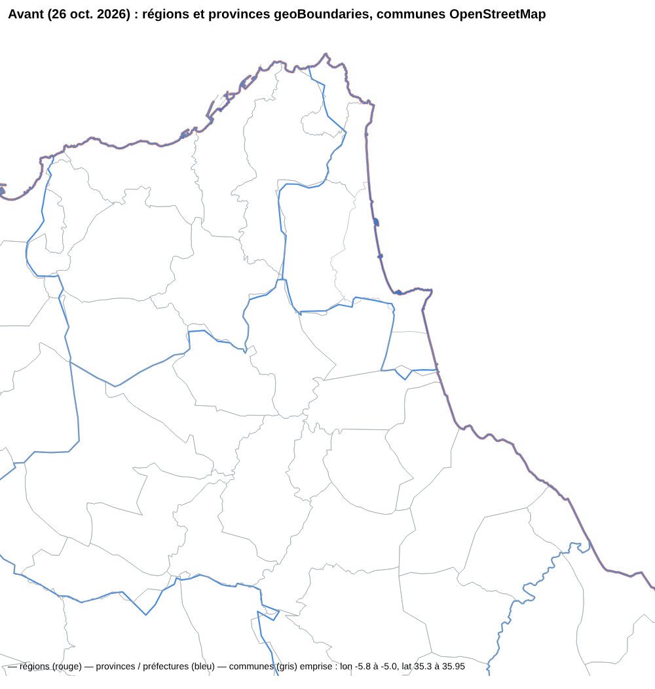

# Alignement des contours région / province / commune (D-GD-43)

Proposition du maître d'ouvrage du 30 octobre 2026 : « Correction : alignement des contours Région / Province /
Commune ». Ce document confronte chaque point de la proposition à l'état du dépôt, consigne ce qui a été corrigé et ce
qui reste ouvert. Le rapport généré de la construction est [`CONTOURS-NIVEAUX.md`](CONTOURS-NIVEAUX.md).

## Constat et diagnostic

Le constat (« des bordures régionales et provinciales traversent les communes ») est **confirmé pour l'état antérieur
au 27 octobre 2026** : les régions et provinces du lot A (PR #339, #340) portaient les contours geoBoundaries 2017, les
communes ceux d'OpenStreetMap, simplifiés séparément. Capture « avant » (mêmes emprise et échelle, autour de Tétouan) :
les limites bleues des provinces coupent les communes grises, par exemple autour de M'diq-Fnideq.

Depuis D-GD-33 (PR #355, 27 octobre 2026), les deux niveaux supérieurs sont l'union des communes, sur une topologie
partagée simplifiée une seule fois. Contrôle indépendant refait le 30 octobre 2026 sur les fichiers livrés : chaque
sommet d'une province ou d'une région est un sommet d'une commune (0 sommet hors des communes) et chaque parent est
exactement l'union de ses enfants (différence symétrique nulle). La construction est reproductible : relancée, elle
redonne les mêmes octets.

**Cause restante possible en préproduction** (non vérifiable d'ici : aucun accès à la préproduction) : une carte
enregistrée, ou une adresse de vue (D-GD-40), **garde la version de couche avec laquelle elle a été composée**. Une
carte composée avant le 27 octobre affiche donc encore les régions ou provinces geoBoundaries à côté des communes
actuelles. Jusqu'ici, seul un avis discret le disait. Corrigé : voir le point 8.

Chaîne d'affichage vérifiée : aucune simplification propre à une couche après la construction. Les tuiles (`ST_AsMVTGeom`,
grille 4096, tampon 64) quantifient de la même façon toutes les couches d'une même tuile, donc des sommets identiques
restent identiques. Toutes les couches vectorielles ont le même zoom maximal (14). Le contour d'une unité
(`/territoires/…/unites/:code`) est servi tel qu'en base.

## Point par point

| Point de la proposition | État |
| --- | --- |
| 1. Référentiel des communes attendues, codes en texte, rapprochement traçable | Fait (D-GD-17, D-GD-33) : `correspondances/hcp-rgph2024-communes.csv` relu (code HCP, nom, contour OSM, méthode, statut), codes en texte ; aucun rattachement deviné (0 ambigu). |
| 2. Complétude dans les deux sens, rapport des anomalies | Fait : 16 communes HCP sans contour (listées), 11 contours OSM sans unité HCP (écartés, listés), 0 ambigu. **Nouveau :** un parent construit sans toutes ses communes est marqué **partiel** (`contour_complet` faux, `communes_sans_contour`) : 13 provinces / préfectures et 8 régions. |
| 3. Validation des communes avant agrégation | Fait : 0 chevauchement entre voisines, 0 géométrie invalide ; 44 lacunes intérieures listées, **jamais comblées** ; 2 auto-intersections que mapshaper n'a pas pu réparer, consignées dans le journal. |
| 4. Topologie commune, union par code | Fait (mapshaper 0.7.98 : accrochage, `dissolve` par code de province puis de région). |
| 5. Une simplification commune par niveau de détail | Une seule simplification (Visvalingam, 20 m) sur la topologie partagée, reprise par les trois niveaux. La référence non simplifiée reste l'extrait OSM livré (`donnees/osm-mar-communes.geojson`, archivé en base). Plusieurs niveaux de détail : non nécessaires à ce jour (tuiles quantifiées). |
| 6. Alignement jusqu'au rendu | Vérifié (voir plus haut). Un réseau de frontières typées par segment n'est pas nécessaire tant que les sommets sont partagés ; il n'a pas été construit. |
| 7. Indicateurs et priorité du HCP | Inchangé : aucun indicateur n'est recalculé par union ; les valeurs publiées par le HCP restent liées par le code à chaque niveau ; aucune somme de pourcentages. |
| 8. Sources, mention, remplacement de geoBoundaries | geoBoundaries est retiré des couches actives depuis D-GD-30 / D-GD-33 (retraits déclarés, anciennes versions conservées pour l'audit). **Nouveau :** mention de provenance dans les trois fiches (« géométries dérivées des contours communaux OpenStreetMap, agrégées selon les rattachements territoriaux HCP ; ce ne sont pas des contours officiels du HCP ») ; une carte qui garde une version antérieure d'une couche de limites administratives affiche une **alerte**, et non plus un avis discret. |

## Contrôles automatisés (CI)

`apps/api/src/db/geodata-sources.test.ts`, cas « contours des niveaux » :

- ensembles de codes comparés aux tables de correspondance : 12 régions, 75 provinces et préfectures (codes, pas
  seulement les nombres) ;
- chaque commune rattachée à une province livrée, de la bonne région ;
- chaque sommet d'une province ou d'une région est un sommet d'une commune ;
- cohérence des marques de contour partiel (province → région).

Plus la validation partagée de chaque GeoJSON livré : géométrie valide, borne, codes uniques et présents.

## Bascule et retour arrière

- **Bascule** : à la fusion puis au déploiement, l'import automatique (D-GD-23) publie une nouvelle version des
  provinces et des régions (même géométrie, propriétés `contour_complet` et `communes_sans_contour` en plus). Les
  communes gardent leur version. Le catalogue sert la nouvelle version. Une carte enregistrée affiche l'alerte pour
  chaque couche de limites restée sur une version antérieure ; il suffit de retirer la couche puis de l'ajouter depuis
  le catalogue.
- **Retour arrière** : les versions antérieures restent en base (versions publiées immuables). Le retour se fait par
  `git revert` de la PR, puis un redéploiement : l'empreinte antérieure redevient celle de la fiche, et l'import
  automatique la reconnaît sans rien recréer.

## Limites connues

- 16 communes du HCP sans contour (Agadir, Al Hoceima, M'diq…) : 13 provinces et 8 régions partielles. La lacune est
  visible sur la carte et signalée, jamais comblée. Il faut reprendre ces communes à la source (OSM ou fichier officiel).
- La géométrie dépend de la qualité des contours communaux d'OpenStreetMap (extraits du 23 octobre 2026). Ce ne sont
  pas des contours officiels. Un fichier officiel du HCP pourra remplacer l'extrait sans changer la logique : relancer
  `construire_niveaux.py`.
- Je n'ai pas pu constater l'état réel de la préproduction (aucun accès d'ici). Captures du navigateur en préproduction,
  aux mêmes emprises : à faire par le maître d'ouvrage après déploiement.
