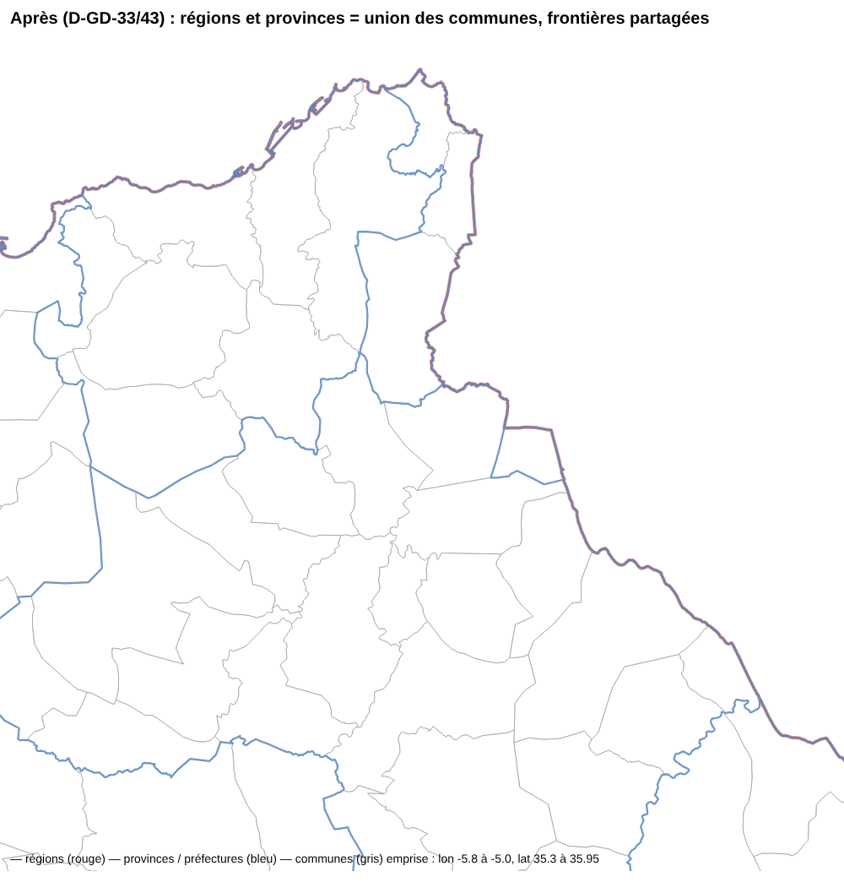

# Alignement des contours région / province / commune (D-GD-44)

Proposition du maître d'ouvrage du 30 octobre 2026 : « Correction : alignement des contours Région / Province /
Commune ». Ce document confronte chaque point de la proposition à l'état du dépôt, consigne ce qui a été corrigé et ce
qui reste ouvert. Le rapport généré de la construction est [`CONTOURS-NIVEAUX.md`](CONTOURS-NIVEAUX.md).

## Constat et diagnostic

Le constat (« des bordures régionales et provinciales traversent les communes ») est **confirmé pour l'état antérieur
au 27 octobre 2026** : les régions et provinces du lot A (PR #339, #340) portaient les contours geoBoundaries 2017, les
communes ceux d'OpenStreetMap, simplifiés séparément. Capture « avant » (mêmes emprise et échelle, autour de Tétouan) :
les limites bleues des provinces coupent les communes grises, par exemple autour de M'diq-Fnideq.

Depuis D-GD-33 (PR #355, 27 octobre 2026), les deux niveaux supérieurs sont l'union des communes, sur une topologie
partagée simplifiée une seule fois. Contrôle indépendant refait le 30 octobre 2026 sur les fichiers livrés : chaque
sommet d'une province ou d'une région est un sommet d'une commune (0 sommet hors des communes) et chaque parent est
exactement l'union de ses enfants (différence symétrique nulle). La construction est reproductible : relancée, elle
redonne les mêmes octets.

**Cause restante possible en préproduction** (non vérifiable d'ici : aucun accès à la préproduction) : une carte
enregistrée, ou une adresse de vue (D-GD-40), **garde la version de couche avec laquelle elle a été composée**. Une
carte composée avant le 27 octobre affiche donc encore les régions ou provinces geoBoundaries à côté des communes
actuelles. Jusqu'ici, seul un avis discret le disait. Corrigé : voir le point 8.

Chaîne d'affichage vérifiée : aucune simplification propre à une couche après la construction. Les tuiles (`ST_AsMVTGeom`,
grille 4096, tampon 64) quantifient de la même façon toutes les couches d'une même tuile, donc des sommets identiques
restent identiques. Toutes les couches vectorielles ont le même zoom maximal (14). Le contour d'une unité
(`/territoires/…/unites/:code`) est servi tel qu'en base.

## Point par point

Source, méthode, comptes et contrôles de la construction : voir [`CONTOURS-NIVEAUX.md`](CONTOURS-NIVEAUX.md), rapport
généré par `construire_niveaux.py`. Ils ne sont pas répétés ici. Les points 1 à 7 de la proposition y sont déjà tenus
depuis D-GD-33 (référentiel et rapprochement traçable, complétude dans les deux sens, validation sans comblement,
topologie partagée, simplification unique, tuiles sans simplification propre, indicateurs HCP inchangés). Apports de
D-GD-44 :

- **contours partiels** : un parent construit sans toutes ses communes porte `contour_complet` faux et
  `communes_sans_contour` (comptes dans le rapport) ;
- **mention de provenance** dans les trois fiches : « géométries dérivées des contours communaux OpenStreetMap, agrégées
  selon les rattachements territoriaux HCP ; ce ne sont pas des contours officiels du HCP » ;
- **alerte de version antérieure** : une couche de limites administratives restée sur une version antérieure dans une
  carte affiche une alerte, et non plus un avis discret ;
- **non construits** : plusieurs niveaux de détail et un réseau de frontières typées par segment. Ils ne sont pas
  nécessaires tant que les sommets sont partagés et que toutes les couches passent par la même quantification de tuiles.

## Contrôles automatisés (CI)

`apps/api/src/db/geodata-sources.test.ts`, cas « contours des niveaux » :

- ensembles de codes comparés aux tables de correspondance : 12 régions, 75 provinces et préfectures (codes, pas
  seulement les nombres) ;
- chaque commune rattachée à une province livrée, de la bonne région ;
- chaque sommet d'une province ou d'une région est un sommet d'une commune ;
- cohérence des marques de contour partiel (province → région).

Plus la validation partagée de chaque GeoJSON livré : géométrie valide, borne, codes uniques et présents.

## Bascule et retour arrière

- **Bascule** : à la fusion puis au déploiement, l'import automatique (D-GD-23) publie une nouvelle version des
  provinces et des régions (même géométrie, propriétés `contour_complet` et `communes_sans_contour` en plus). Les
  communes gardent leur version. Le catalogue sert la nouvelle version. Une carte enregistrée affiche l'alerte pour
  chaque couche de limites restée sur une version antérieure ; il suffit de retirer la couche puis de l'ajouter depuis
  le catalogue.
- **Retour arrière** : les versions antérieures restent en base (versions publiées immuables). Le retour se fait par
  `git revert` de la PR, puis un redéploiement : l'empreinte antérieure redevient celle de la fiche, et l'import
  automatique la reconnaît sans rien recréer.

## Limites connues

- Communes du HCP sans contour (liste dans le rapport) : leurs parents sont partiels. La lacune est visible et signalée,
  jamais comblée. Il faut reprendre ces communes à la source (tâche GEO-COMMUNES-SANS-CONTOUR).
- La géométrie dépend de la qualité des contours communaux d'OpenStreetMap (extraits du 23 octobre 2026). Ce ne sont
  pas des contours officiels. Un fichier officiel du HCP pourra remplacer l'extrait sans changer la logique : relancer
  `construire_niveaux.py`.
- Je n'ai pas pu constater l'état réel de la préproduction (aucun accès d'ici). Captures du navigateur en préproduction,
  aux mêmes emprises : à faire par le maître d'ouvrage après déploiement.
